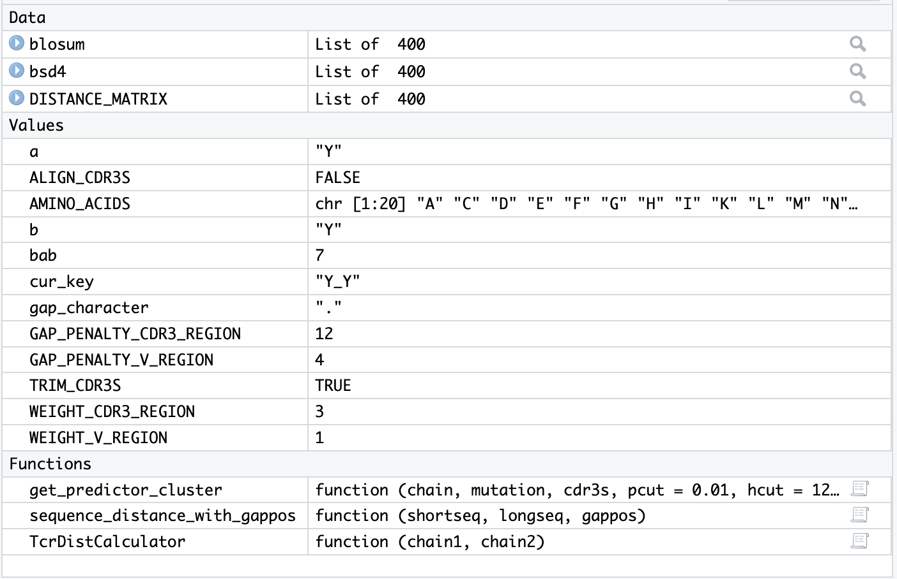

## A function to give predictor values based on clusters of TCRs associated with mutations

The function 
```
get_predictor_cluster
```
is put in the code file

[get_predictor.R](https://github.com/Sun-lab/cancer_reactive_TCR/blob/main/somatic_mutation/tcr_cluster_function/get_predictor.R)

This file needs to source another file, which further sources another file, with the relationship as listed below:

```bash
get_predictor.R
  	├── _tcr_dist.R
               	   ├── _blosum62.R
```
When running the function in 

[get_predictor.R](https://github.com/Sun-lab/cancer_reactive_TCR/blob/main/somatic_mutation/tcr_cluster_function/get_predictor.R)

it also loads data files 
```
sprintf("data/cluster_asso/cluster_asso_%s_%d.tsv", chain, hcut)
sprintf("data/cluster_member/cluster_member_%s_%d.tsv", chain, hcut)
```
depending on the input parameter values for ```chain``` and ```hcut```. 

Example code for using the function is:
```
source("get_predictor.R")

chain = "alpha"
hcut = 12
pcut = 0.01
mutation = "ARID1A:1:27106648:G:A"
cdr3s = c("CAADRGSTLGRLYF",
                "CAAEPNGANNLFF",
                "CAAFSGGYNKLIF",
                "CAAFSVSSASKIIF",
                "CAAGDRVWGWELPTHF",
                "CAAGFSGGYNKLIF",
                "CAAGGLGQNFVF",
                "CAAGGTDKLIF",
                "CAAGSNSGYSTLTF",
                "CAAIGDQGGKLIF")


output_list = get_predictor_cluster(chain, mutation, cdr3s, pcut, hcut)
output_list$n_cluster # output will be 0 based on inputs above
output_list$n_tcr # output will be 0 based on inputs above
```


### Inputs and requirements:

- ```chain```: string format, chain type, must be one of "alpha" and "beta"

- ```mutation```: string format, somatic mutation, must exist in the association pvalue data file, the path to the corresponding file follows the format ```sprintf("data/cluster_asso/cluster_asso_%s_%d.tsv", chain, hcut)```

- ```cdr3s```:  a vector of strings, the vector of CDR3 amino acid sequences from one individual. None of the CDR3 amino acid sequences can have characters outside of the 20 amino acids, and none of them can have sequence length < 5

- ```hcut```: integer format, height cutoff for TCR clustering, must be one of 12 and 20

- ```pcut```: float format, pvalue cutoff

### Outputs:

The output item is a list of two elements, under the given chain type, somatic mutation, vector of CDR3 sequences, height cutoff and pvalue cutoff, 

- ```output_list$n_cluster```: the number of clusters associated with given somatic mutation and each also having at least one of the given CDR3 sequences falling into it. One CDR3 is said to fall into one cluster if: the distance from the CDR3 to the cluster is no larger than the height cutoff, and also the distance between the CDR3 and the cluster needs to the smallest among the distances between the CDR3 and all clusters associated with the given somatic mutation. If there are ties, all clusters with the smallest distance will be included. This one does not show difference when there are duplicates in the vector of CDR3 amino acid sequences. 

- ```output_list$n_tcr```: in given vector of CDR3 sequences, the number of CDR3s (no requirement on uniqueness) falling within height cutoff distance of any of the clusters associated with given somatic mutation. This one will show difference when there are duplicates in the vector of CDR3 amino acid sequences. 

### Further notes:

The process of sourcing R files in order to load the function will load the following objects as listed in the screenshot below into R workspace:



Additional attention may be needed to avoid them having conflict with objects used in current workspace.
